###### ATLANTIC TECHNOLOGICAL UNIVERSITY

### Cloud Infrastructure Security

###### Project Documentation | Terraform & Sentinel

#### Overview

Terraform and HashiCorp Sentinel are used to check AWS infrastructure security requirements before deployment.

#### Technologies

- Terraform
- HashiCorp Sentinel
- HCP Terraform
- AWS
- GitHub

#### Terraform Setup

- Terraform 1.15+
- AWS Provider 6.x
- Provider version locked in `.terraform.lock.hcl`

##### Validation

- `terraform init` — passed
- `terraform validate` — passed

#### AWS Configuration

AWS region and resource tags are configured using Terraform variables.

Default tags:

- Project
- Environment
- Owner
- ManagedBy

Input variables are validated to prevent empty values.

#### EC2 Infrastructure

The Terraform configuration defines an EC2 instance with:

- Configurable AMI and instance type
- Encrypted gp3 root volume
- IMDSv2 enabled
- Standard resource tags

These settings are checked by Sentinel policies.

#### AMI Version Pinning

The EC2 instance uses a fixed Amazon Linux 2023 AMI for the Ireland region (`eu-west-1`).

The AMI ID was retrieved from AWS Systems Manager Parameter Store and is configured through the `ami_id` variable.

Pinning the AMI prevents unexpected image changes during future deployments. Image updates must be reviewed and applied
explicitly.

#### Network Infrastructure

The infrastructure uses a dedicated VPC instead of the AWS Default VPC.

- VPC CIDR: `10.0.0.0/16`
- DNS support and hostnames enabled
- Standard resource tags

##### Private Network

- Private subnet CIDR: `10.0.1.0/24`
- Dedicated route table with local VPC routing only
- No automatic public IP assignment
- No Internet Gateway or NAT Gateway

##### Security Group

The EC2 instance uses a dedicated Security Group with least-privilege network rules.

- No inbound traffic is permitted.
- SSH access from `0.0.0.0/0` is prohibited.
- Outbound traffic is restricted to HTTPS (TCP 443).
- Security Group rules are managed using separate Terraform resources.

Sentinel validates the network security configuration.

##### EC2 Network Integration

The EC2 instance is deployed into the dedicated private subnet and uses the project Security Group.

- Private subnet attachment
- Dedicated Security Group
- Public IPv4 assignment disabled
- No direct internet connectivity

Terraform manages resource dependencies automatically.

##### Terraform Plan Validation

The Terraform plan was successfully generated for AWS Ireland (`eu-west-1`).

Validation results:

- 7 resources to add
- 0 resources to change
- 0 resources to destroy
- EC2 root EBS encryption enabled
- IMDSv2 required
- Public IP assignment disabled
- Private subnet and dedicated Security Group configured

The complete plan output is available in [Terraform Plan Evidence](evidence/terraform-plan.txt).
This local plan did not deploy AWS resources.

#### Sentinel CLI Setup

HashiCorp Sentinel CLI v0.41.0 is installed locally on Windows.

Installation:

- Download the Sentinel CLI ZIP from HashiCorp.
- Extract `sentinel.exe` to `C:\Tools\Sentinel`.
- Add `C:\Tools\Sentinel` to the system PATH.

Validation:

- `sentinel version` — passed (v0.41.0).

Sentinel CLI was used to develop and test policies locally.

#### AWS Region Policy

The `aws-region.sentinel` policy restricts AWS resource deployment to approved regions.

- Approved regions are configured through `allowed_regions`.
- The policy checks planned AWS resource creation and updates.
- Unknown or unapproved regions are rejected.
- Plans without relevant changes are allowed.
- Enforcement level: `hard-mandatory`.

##### Local Testing

Validated using Sentinel CLI v0.41.0:

- Approved region: PASS
- Unapproved region: PASS (rejected as expected)
- Unknown region: PASS (rejected as expected)
- Resource replacement: PASS
- No changes: PASS

All five test scenarios passed using `sentinel test -verbose`.

##### Negative Test Evidence

The AWS Region Policy was tested against a non-compliant configuration using `us-east-1`, while only `eu-west-1` is
permitted.

The Sentinel test passed because the policy correctly rejected the unapproved region (`main = false`).

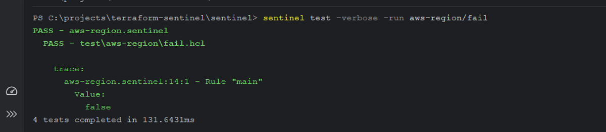

#### Digital Sovereignty: Decisions and Limitations

The infrastructure is restricted to AWS Ireland (`eu-west-1`) to support the digital sovereignty requirements of this
project.

**Decisions:**

- **Region restriction:** The Sentinel AWS Region Policy rejects infrastructure changes targeting unapproved regions.
- **Data residency:** Deploying resources in Ireland supports geographical control over infrastructure and data storage.
- **Policy enforcement:** The `hard-mandatory` enforcement level prevents deployment when a policy check fails.

**Limitations:**

- **Data replication and backups:** Restricting the AWS region does not automatically prevent data replication or
  backups outside Ireland.
- **Administrative access:** Region restrictions do not control where administrators or external service providers
  access infrastructure from.
- **Jurisdiction:** Hosting infrastructure in Ireland does not eliminate jurisdictional or legal dependencies on cloud
  service providers.
- **Runtime changes:** Sentinel evaluates Terraform plans but does not prevent changes made directly in AWS outside the
  Terraform workflow.

**Recommendation:**

Additional controls should be considered for data residency, backup locations, access management, and continuous
compliance monitoring.

#### Design Decisions and Justifications

#### Design Decisions and Justifications

| Design Decision                                                            | Purpose                   | Justification                                                                                                                                                                                                                       |
|----------------------------------------------------------------------------|---------------------------|-------------------------------------------------------------------------------------------------------------------------------------------------------------------------------------------------------------------------------------|
| Restrict AWS deployments to `eu-west-1`                                    | Digital Sovereignty       | Keeps planned infrastructure deployments within the approved Ireland region and rejects deployments to unapproved regions.                                                                                                          |
| Enforce AWS region restrictions with Sentinel                              | Digital Sovereignty       | Prevents non-compliant Terraform plans from being applied through the HCP Terraform workflow.                                                                                                                                       |
| Use a private subnet without a public IP address                           | Infrastructure Security   | Reduces direct exposure of the EC2 instance to the public internet.                                                                                                                                                                 |
| Require encrypted EBS volumes                                              | Infrastructure Security   | Protects stored data against certain risks associated with unencrypted storage.                                                                                                                                                     |
| Require IMDSv2                                                             | Infrastructure Security   | Reduces risks associated with unauthorized access to EC2 instance metadata.                                                                                                                                                         |
| Restrict Terraform provider sources and versions                           | IaC Supply Chain Security | Reduces the risk of using unapproved providers and makes dependency changes more predictable.                                                                                                                                       |
| Restrict external Terraform module sources and require version constraints | IaC Supply Chain Security | The Sentinel policy validates module sources and version constraints when external modules are used.  This project does not use external Terraform modules; the policy was verified using positive and negative test scenarios. |
| Use `.terraform.lock.hcl`                                                  | IaC Supply Chain Security | Records selected provider versions and checksums to support reproducible dependency installation.                                                                                                                                   |
| Use `hard-mandatory` Sentinel policies                                     | Policy Enforcement        | Prevents infrastructure changes through HCP Terraform when mandatory security requirements are not satisfied.                                                                                                                       |
| Use separate AWS IAM roles for Plan and Apply                              | Access Control            | Separates read-only planning permissions from infrastructure modification permissions.                                                                                                                                              |
| Use GitHub Pull Requests                                                   | Change Management         | Provides version history and a reviewable record of infrastructure changes.                                                                                                                                                         |

#### EC2 Security Policy

The `ec2-security.sentinel` policy enforces security requirements for AWS EC2 instances before deployment.

##### Security Controls

- **Instance Type:** Only approved EC2 instance types are permitted.
- **EBS Encryption:** Root EBS volumes must be encrypted.
- **IMDSv2:** Instance metadata must require IMDSv2 (`http_tokens = "required"`).
- **Missing Configuration:** Empty root block device or metadata settings are rejected.
- **Enforcement:** `hard-mandatory`.

Approved instance types are configured through the `allowed_instance_types` parameter in `sentinel.hcl`.

##### Testing and Validation

Validated locally using Sentinel CLI v0.41.0.

| Test Scenario             | Expected Policy Result | Test Status                                                         |
|---------------------------|------------------------|---------------------------------------------------------------------|
| Secure EC2 configuration  | Allow                  |  |
| Unencrypted EBS volume    | Deny                   |  |
| Unapproved instance type  | Deny                   |  |
| IMDSv1 permitted          | Deny                   |  |
| Missing security settings | Deny                   |  |

All five EC2 Security Policy tests passed using `sentinel test -verbose`.

Cloud-based validation is documented in the HCP Terraform section below.

#### Terraform Supply Chain Security

The `terraform-supply-chain.sentinel` policy validates Terraform provider sources to reduce supply chain risks.

##### Provider Source Validation

- Only approved Terraform provider sources are permitted.
- Approved sources are configured through `allowed_provider_sources`.
- The policy requires providers to declare version constraints.
- Enforcement level: `hard-mandatory`.

##### Testing and Validation

Validated locally using Sentinel CLI v0.41.0.

| Test Scenario              | Expected Result | Status                                                              |
|----------------------------|-----------------|---------------------------------------------------------------------|
| Approved AWS provider      | Allow           |  |
| Unapproved provider source | Deny            |  |

Both providers source validation tests passed using `sentinel test -verbose`.

Provider version validation and Terraform module controls were added in a subsequent development increment, as
documented below.

##### Provider Version Validation

- Terraform providers must declare version constraints.
- Providers without version constraints are rejected.

##### Module Source and Version Validation

- Only approved Terraform module sources are permitted.
- Approved sources are configured through `allowed_module_sources`.
- External modules must declare version constraints.
- Unapproved module sources and missing version constraints are rejected.
- Configurations without module calls are permitted.

##### Additional Testing and Validation

| Test Scenario                           | Expected Result | Status                                                              |
|-----------------------------------------|-----------------|---------------------------------------------------------------------|
| Provider without version constraint     | Deny            |  |
| Approved module with version constraint | Allow           |  |
| Unapproved module source                | Deny            |  |
| Module without version constraint       | Deny            |  |

All six Terraform Supply Chain test scenarios passed using `sentinel test -verbose`.

Cloud-based validation is documented in the HCP Terraform section below.

##### Network Security Policy

The Network Security Policy enforces secure inbound access to AWS Security Groups using HashiCorp Sentinel and Terraform
plan data (`tfplan/v2`).

**Security controls:**

- Blocks public SSH access (TCP port 22) from `0.0.0.0/0` and `::/0`.
- Blocks unrestricted public access using protocol `-1`.
- Validates standalone `aws_vpc_security_group_ingress_rule` resources.
- Validates inline `ingress` rules within `aws_security_group` resources.
- Evaluates managed resources being created or updated.
- Allows public HTTPS (TCP port 443).

**Enforcement:** `hard-mandatory`

**Testing and validation:**

- 7 Network Security Policy test scenarios passed.
- 23 Sentinel test scenarios passed across all four policies.
- Positive and negative test cases validate allowed and prohibited configurations.

**Scope:** The policy covers the resource types and ingress configurations listed above. Legacy
`aws_security_group_rule` resources are not currently evaluated.

#### HCP Terraform Integration and Deployment

The Terraform infrastructure and Sentinel policies were connected to HCP Terraform through GitHub. Infrastructure
was 
defined and validated locally before cloud deployment. AWS IAM access was configured for remote execution; an
initial 
plan-only run verified the proposed changes, and a later apply run created the resources.

##### 1. HCP Terraform Workspace and Sentinel Policy Set

| Component                   | Configuration                          |
|-----------------------------|----------------------------------------|
| HCP organization            | `ATU-LABS`                             |
| Workspace                   | `terraform-sentinel-dev`               |
| GitHub repository           | `maxvanny2010/terraform-sentinel`      |
| VCS branch                  | `master`                               |
| Terraform working directory | `terraform`                            |
| Policy set                  | `atu-lab-policies-vcs`                 |
| Sentinel policies directory | `sentinel`                             |
| Execution mode              | Remote                                 |
| Policy enforcement          | `hard-mandatory`                       |
| AWS region                  | `eu-west-1`                            |
| AWS authentication          | OIDC and temporary AWS STS credentials |

The VCS-backed Sentinel policy set evaluates Terraform runs before deployment.

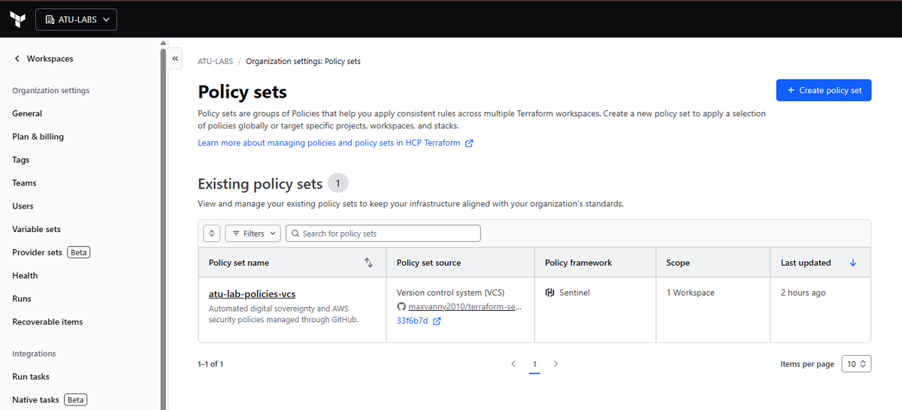

##### 2. AWS IAM Authentication for Remote Execution

HCP Terraform uses AWS Dynamic Provider Credentials through OIDC and temporary AWS STS credentials. Two separate AWS IAM
roles were configured for different phases:

- **Plan role:** `hcp-terraform-sentinel-plan`, with the AWS-managed `AmazonEC2ReadOnlyAccess` policy to inspect
  resources without allowing infrastructure changes.
- **Apply role:** `hcp-terraform-sentinel-apply`, with the custom `TerraformSentinelApplyPolicy` to perform
  project-scoped infrastructure changes.

The Plan role was prepared for the remote planning stage. The Apply role's write permissions were configured and tested
before deployment.

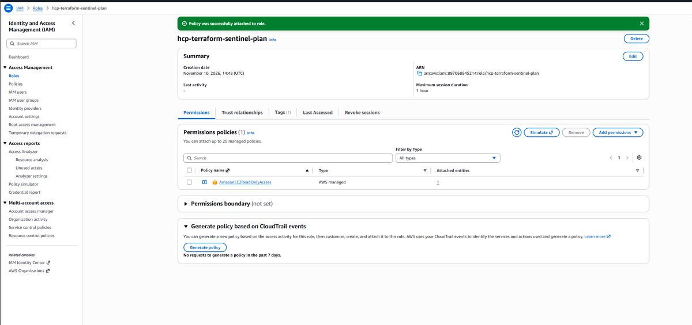

##### 3. HCP Terraform Plan and Sentinel Validation

A **plan-only** run used Terraform v1.17.1 to inspect the proposed infrastructure without deploying it.

- 7 resources to add
- 0 resources to change
- 0 resources to destroy
- 4 of 4 Sentinel policy checks passed

| Sentinel policy               | Result                                                              |
|-------------------------------|---------------------------------------------------------------------|
| AWS Region Policy             |  |
| EC2 Security Policy           |  |
| Terraform Supply Chain Policy |  |
| Network Security Policy       |  |

At this stage, no AWS infrastructure had been created by HCP Terraform.

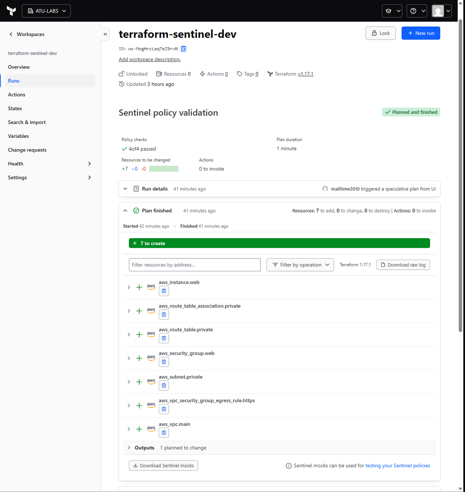

##### 4. Apply Role Permission Validation

Before Apply, AWS IAM policy simulation was used to test the permissions of `hcp-terraform-sentinel-apply`.

| Simulated request                                                       | Decision       |
|-------------------------------------------------------------------------|----------------|
| `ec2:CreateVpc` with `Project=terraform-sentinel` and `Environment=dev` | `allowed`      |
| `ec2:CreateVpc` with `Project=other-project`                            | `implicitDeny` |
| `ec2:RunInstances` for `t3.micro` with approved project tags            | `allowed`      |
| `ec2:RunInstances` for `t3.large` with approved project tags            | `implicitDeny` |

These simulations validated specific IAM policy decisions; they were not a complete test of every AWS API operation
needed for deployment.

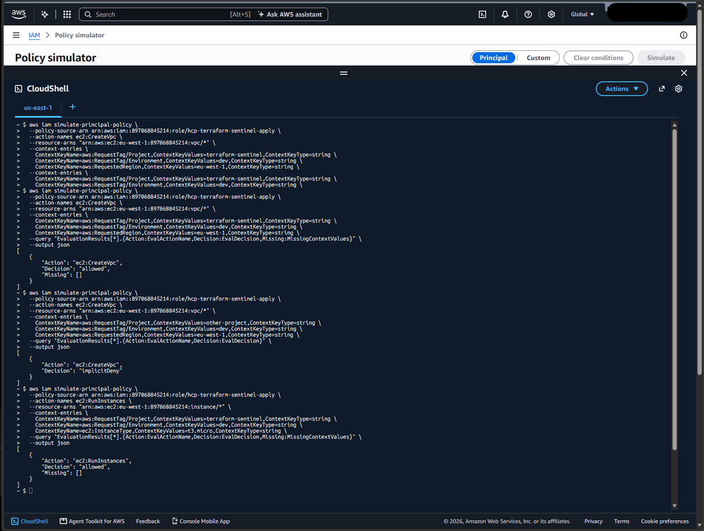

##### 5. Successful Terraform Apply

A subsequent HCP Terraform run passed all four Sentinel policy checks and completed **Apply** successfully.

- 7 resources added
- 0 resources changed
- 0 resources destroyed
- HCP Terraform state version created

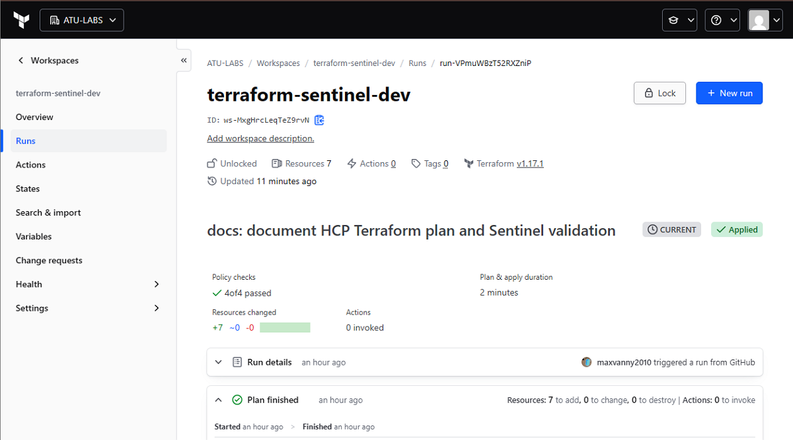

The following managed Terraform resources were created:

1. `aws_vpc.main`
2. `aws_subnet.private`
3. `aws_route_table.private`
4. `aws_route_table_association.private`
5. `aws_security_group.web`
6. `aws_vpc_security_group_egress_rule.https`
7. `aws_instance.web`

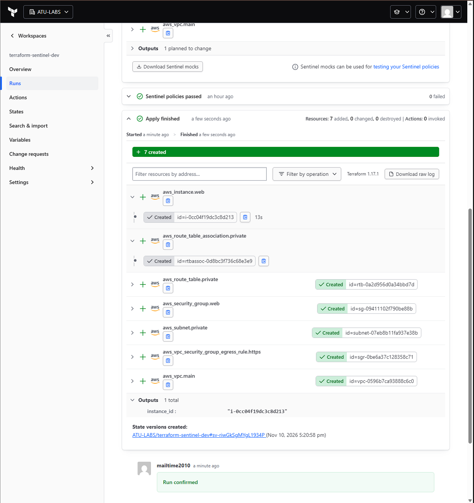

##### 6. AWS Infrastructure Verification

###### VPC and Resource Tags

The VPC was created in `eu-west-1` with CIDR `10.0.0.0/16`. Its tags include `Project=terraform-sentinel`,
`Environment=dev`, `Owner=ATU-LABS`, and `ManagedBy=Terraform`.

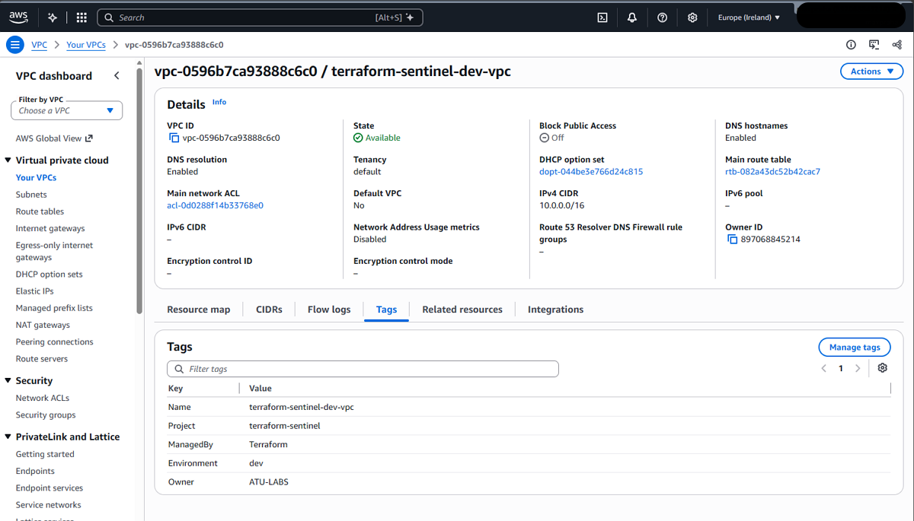

###### Network Architecture

The VPC contains a dedicated private subnet and route table. The route table is configured for local VPC routing only;
no Internet Gateway or NAT Gateway was provisioned by this configuration.

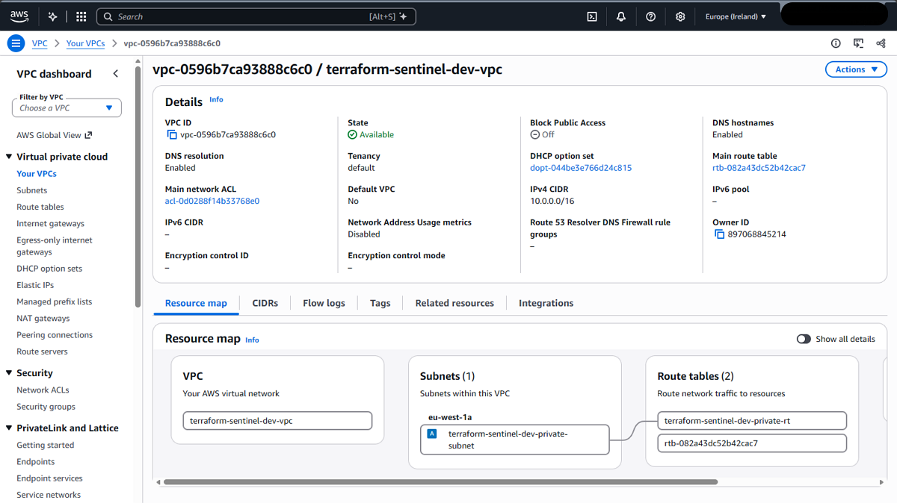

###### Private Subnet

- Subnet CIDR: `10.0.1.0/24`
- Availability Zone: `eu-west-1a`
- Automatic public IPv4 assignment: Disabled
- Dedicated route table associated with the subnet

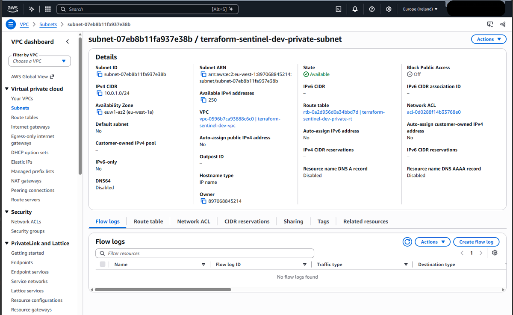

###### EC2 Security Group

- Inbound rules: None
- Outbound rule: HTTPS, TCP 443, destination `0.0.0.0/0`

The Security Group restricts permitted outbound traffic to TCP port 443. It does not by itself provide internet
connectivity; the private subnet has no configured internet route.

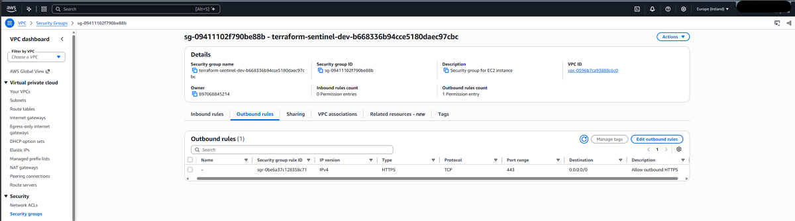

###### EC2 Instance

- Instance ID: `i-0cc04f19dc3c8d213`
- Instance type: `t3.micro`
- OS image: Amazon Linux 2023
- State at verification: Running
- Private IPv4: `10.0.1.107`
- Public IPv4: None
- Subnet: Dedicated private subnet
- IMDSv2: Required
- SSH key pair: None
- Root EBS: Encrypted gp3 (specified in the Terraform configuration)

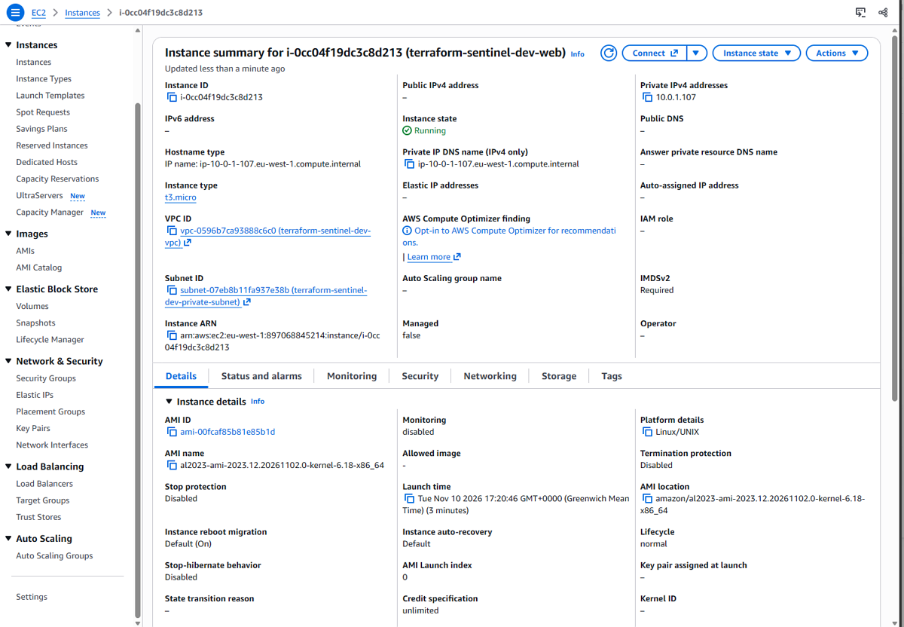

##### 7. Deployment Outcome

The project demonstrated a version-controlled Terraform workflow with local Sentinel testing, HCP Terraform plan 
validation, IAM-based separation of Plan and Apply permissions, mandatory Sentinel policy checks, and successful
AWS 
resource provisioning.

All seven planned Terraform resources were created and their main security settings were verified in the AWS
Console. 
The screenshots above document the configuration, policy evaluation, deployment and resulting infrastructure.

#### Infrastructure Cleanup and Terraform Destroy

After successful deployment and security validation, the test infrastructure
was removed using HCP Terraform.

The destroy operation was executed through the HCP Terraform workspace
`terraform-sentinel-dev`.

##### Destroy Results

- 0 resources added
- 0 resources changed
- 7 resources destroyed
- 4 of 4 Sentinel policies passed
- 0 managed resources remaining in the workspace

The destroy operation completed successfully without manually deleting
individual AWS resources.

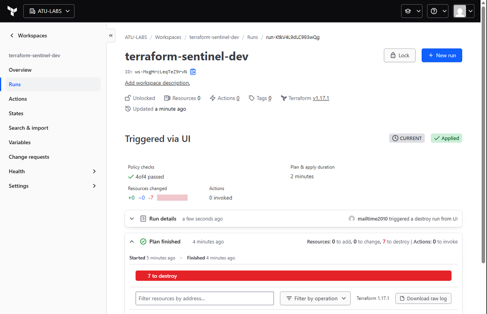

##### AWS Verification

The AWS EC2 console confirmed that the project instance
`terraform-sentinel-dev-web` was terminated.

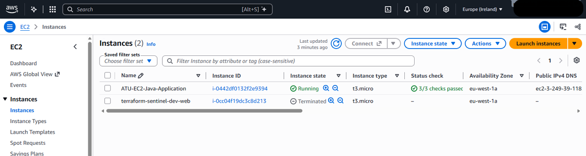

##### Conclusion

The complete infrastructure lifecycle was validated:

1. Terraform configuration and validation
2. Sentinel policy enforcement
3. Infrastructure planning
4. Infrastructure deployment
5. AWS security verification
6. Controlled infrastructure destruction

All seven Terraform-managed resources were successfully removed.
